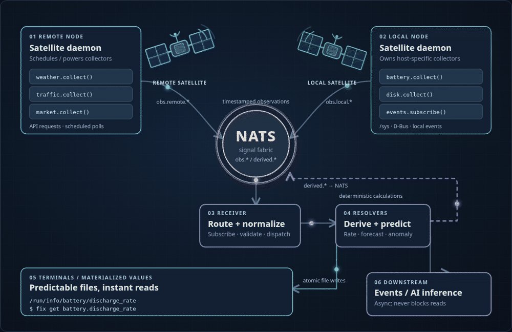

# Fix

**A lightweight, GPS-inspired, NATS-native information system.**

Fix is a proposed system for turning observations from unrelated local and remote sources into immediately queryable information. Collectors read sources on demand, *satellite* daemons schedule or trigger those collectors, NATS carries timestamped observations, and resolvers calculate derived values. The results can be published as events and materialized as tiny, predictable files for low-latency reads.

> **Status:** Architecture/design proposal. The animated diagram is implemented; the collectors, NATS services, resolver engine, and CLI shown in it are **not yet implemented**.

## Architecture

[](index.html)

**[View the standalone HTML/SVG diagram](index.html)** — open `index.html` locally in a browser for the original SVG animations and the pause/play control.

GitHub README pages **do not execute embedded HTML or JavaScript**, and GitHub's SVG image viewer does **not support inline SVG animation**. The image above is therefore an **animated GIF generated from the real HTML/SVG diagram**, not an interactive embed. To host the interactive version online, enable **GitHub Pages** for the repository's root directory; its `index.html` will be served as the website. [GitHub's SVG documentation](https://docs.github.com/en/repositories/working-with-files/using-files/working-with-non-code-files) · [GitHub Pages](https://docs.github.com/en/pages/getting-started-with-github-pages/what-is-github-pages)

### Pipeline

```text
Local and remote sources
          │
          ▼
     Collectors
          │  scheduled / event-driven activation
          ▼
 Local / remote satellite daemons
          │  timestamped observations
          ▼
      NATS subjects  (obs.*)
          │
          ▼
     Receiver / router
          │
          ▼
       Resolvers
          ├────────► NATS subjects (derived.*) ──► downstream subscribers
          │
          └────────► Materialized scalar files ──► shell / CLI
                                    │
                                 /run/info/
```

### Vocabulary

| Component | Responsibility |
| --- | --- |
| **Collector** | Obtain one raw observation from a source on demand; keep adapters small and independent. |
| **Satellite** | Run collectors on a schedule or in response to events, and publish observations via NATS. *Local* and *remote* are deployment modes, not distinct protocols. |
| **Receiver** | Subscribe to NATS, validate and normalize envelopes, and dispatch observations. |
| **Resolver** | Compute deterministic values, aggregate measurements, and make forecasts from observations and existing state. |
| **Terminal** | Present a precomputed value at a predictable filesystem path, or via a thin CLI. |

The GPS analogy is conceptual: satellites publish observations; a receiver accepts signals; resolvers derive usable state. Unlike GPS, **not every computation requires multiple sources**.

## Intended interface (not yet implemented)

The fastest read is a single local file operation:

```bash
battery=$(cat /run/info/battery/level)
rate=$(cat /run/info/battery/discharge_rate)
remaining=$(cat /run/info/disk/root/days_remaining)
```

An eventual convenience CLI would expose the same keys:

```bash
fix get battery.level
fix get battery.discharge_rate
fix get weather.temperature
fix get disk.root.days_remaining
```

Every call returns **one unformatted scalar** and performs **no live collection**. Units, timestamps, source identity, and freshness belong in separate metadata. An old cached value must be identifiable as stale; missing values must not be silently invented.

Illustrative NATS subjects:

```text
obs.battery.energy
obs.weather.temperature
obs.disk.root.available

derived.battery.discharge_rate
derived.disk.root.days_remaining
```

The observations may carry timestamped structured payloads, but the local materialized files expose plain values. NATS JetStream can optionally retain history; `/run/info` is ephemeral and **does not survive reboot**. Any required long-term history needs a separate durable store.

## Design principles

- **Reading never triggers collection.** Prompt execution is independent of network, weather, or AI latency.
- **Collect on appropriate schedules or events.** Battery telemetry might refresh every few seconds; weather may refresh far less often.
- **Local and remote nodes use the same message protocol.** The location of a collector is an implementation detail.
- **Resolvers are independent of AI.** AI inference may subscribe asynchronously, but cannot block deterministic calculations or cache reads.
- **Publish defensively.** Include timestamps, units, source identity and a means to handle duplicate or delayed observations.
- **Update files atomically.** Readers should see a complete previous or new value, never a partial write.
- **Keep the first implementation small.** NATS, one local satellite, one remote satellite (when needed), one receiver, a few resolvers, and a file writer.

## Repository

```text
.
├── README.md
├── index.html                 # Single-source animated HTML + inline SVG
└── docs/
    └── architecture.gif      # GitHub-compatible animated preview
```

No JavaScript packages, fonts, frameworks, or build tools are required to view the diagram:

```bash
xdg-open index.html
```

The animated GIF is only a documentation export. **Edit `index.html`**, then regenerate the GIF if you change the diagram.
